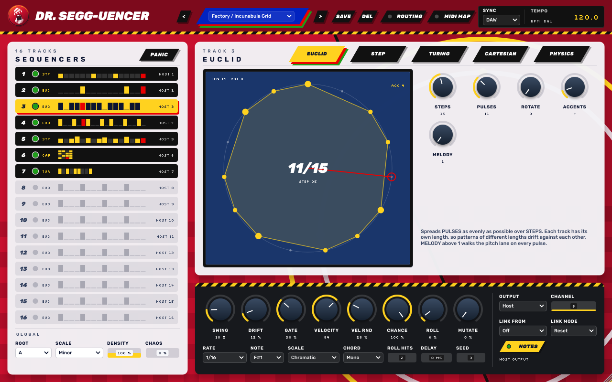
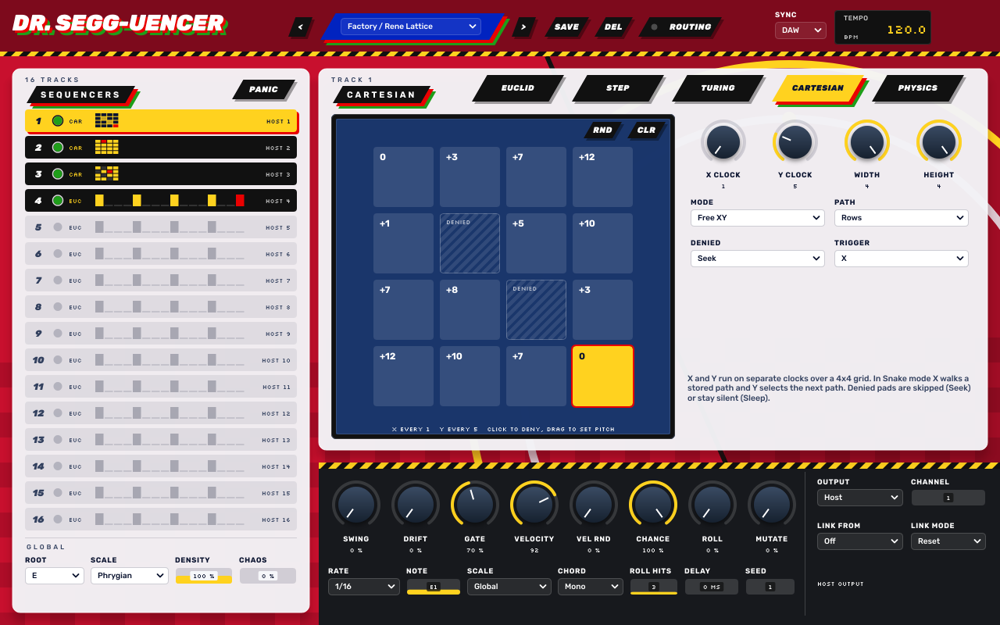
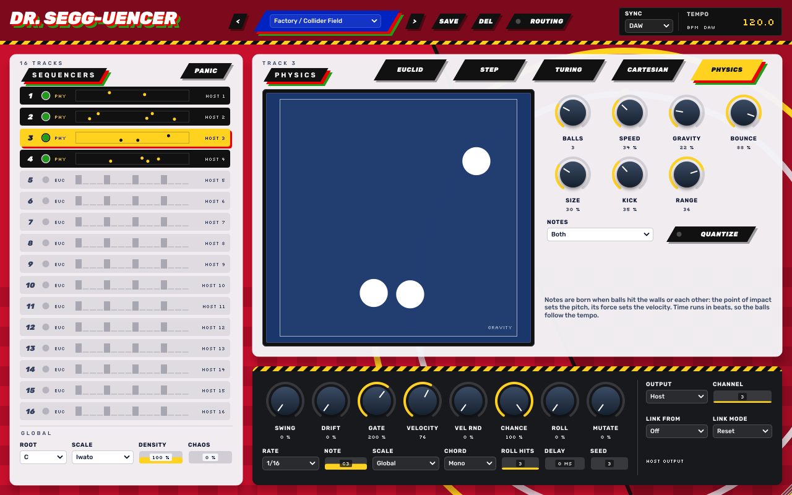
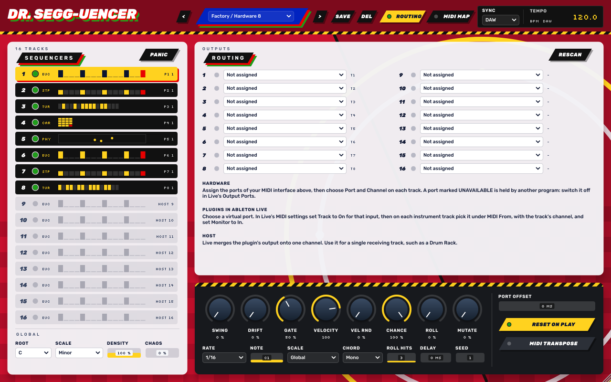
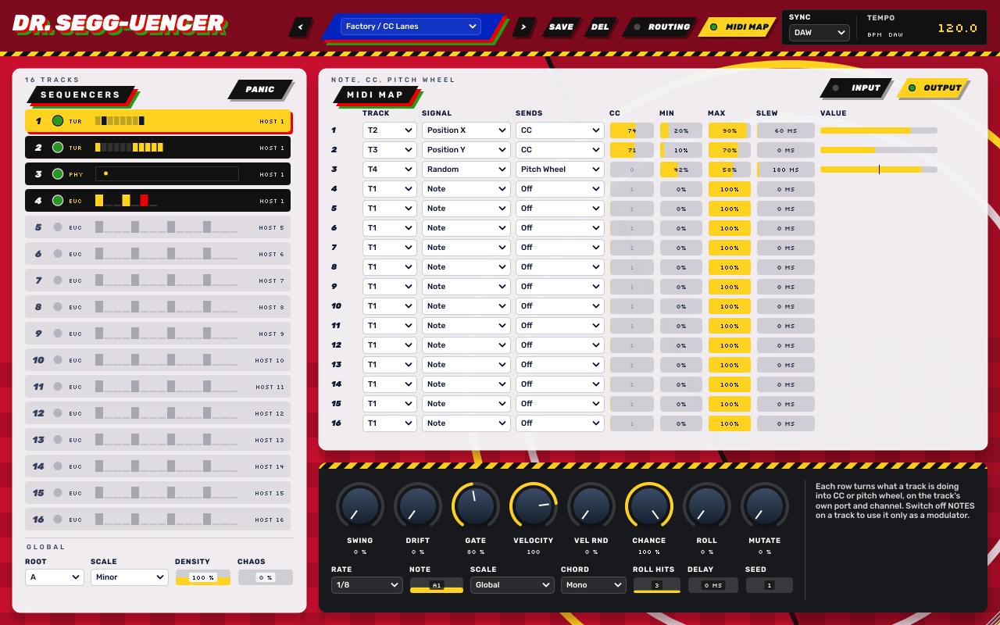

# DR. SEGG-UENCER

Multi-sequencer MIDI a 16 tracce simultanee in formato **VST3 / AU / AAX** (C++ / JUCE 8), pensato per Ableton Live, per pilotare strumenti hardware e plugin. È il compagno di [SONIC GRAIN](https://github.com/gianlucasofia90/SONICGRAIN): stessa famiglia grafica (tema Egg Lab), stessa toolchain.

Il suono di riferimento è quello di *Incunabula* e *Amber* degli Autechre e di *Selected Ambient Works 85-92* di Aphex Twin: pattern di lunghezze diverse che si spostano l'uno sull'altro, mutazioni piccole e lente, macchine che si influenzano a vicenda.



| Cartesian | Physics |
|---|---|
|  |  |

## I cinque sequencer
Ogni traccia può usare uno qualsiasi dei cinque tipi, e tutte le tracce suonano insieme.

| Tipo | Riferimento | Come funziona |
|---|---|---|
| **Euclid** | Torso T-1 | Distribuisce `Pulses` in modo uniforme su `Steps` (fino a 32), con `Rotate`, `Accents` e `Melody`, che fa percorrere le altezze a ogni pulsazione. |
| **Step** | 16 step classico | 16 passi con corsie Pitch, Vel, Gate, Chance e Ratch. Direzioni Forward, Reverse, Pendulum, Random, Brownian. |
| **Turing** | Music Thing Turing Machine | Registro a scorrimento ad anello, fino a 32 bit. `Lock` come la manopola grande del modulo: 100 % ripete, 50 % è casuale, 0 % ripete a lunghezza doppia, nel mezzo il loop scivola poche note alla volta. `Density` dirada le note, come l'uscita Pulses. |
| **Cartesian** | Make Noise René | Griglia 4×4 con X e Y su clock separati. In `Free XY` gli assi sono indipendenti; in `Snake` X percorre uno degli 8 percorsi e Y passa al percorso successivo. I pad negati si saltano (`Seek`) o restano muti (`Sleep`). |
| **Physics** | Rozeta Collider | Fino a 8 palline in una scatola. Una nota nasce quando colpiscono le pareti o si scontrano: il punto d'impatto dà l'altezza, la forza dà la velocity. Gravity, Bounce, Kick, Size; `Quantize` allinea i colpi alla griglia della traccia. |

## Comuni a ogni traccia
- **Rate**: da 4 bar a 1/64, terzine, puntate e ritmi `N:M` (N passi ogni M battiti: 5:1, 7:1, 11:1 ...). Ogni traccia ha il suo.
- **Swing**, **Drift** (micro-timing che vaga lentamente), **Delay** in ms.
- **Gate** fino all'800 % del passo, **Velocity**, **Vel Rnd**, **Chance**.
- **Roll**: probabilità di una raffica di `Roll Hits` colpi dentro il passo.
- **Mutate**: variazioni piccole; il pattern si allontana e tende a tornare.
- **Note**, **Scale** (Global, Chromatic per le note di batteria, o una delle 18 scale), **Chord** (accordi costruiti sulla scala).
- **Seed**: stesso seed, stessa musica, anche in bounce offline e con qualsiasi buffer audio.

### Link tra tracce
Una traccia ne ascolta un'altra (`Link From`), con precisione al campione:
- **Reset**: riparte a ogni colpo della sorgente.
- **Clock**: avanza solo quando la sorgente suona.
- **Transpose**: segue l'altezza della sorgente.
- **Follow**: suona solo subito dopo la sorgente.
- **Choke**: la sorgente la zittisce.

### Globali
`Root` e `Scale`, `Density` (scala la Chance di tutte le tracce), `Chaos` (si somma a Mutate), Sync DAW o FREE. Nella pagina ROUTING: `Port Offset`, `Reset on Play`, `MIDI Transpose` (le note in ingresso traspongono tutto, riferimento C3 = MIDI 60). `PANIC` chiude tutte le note su tutte le uscite.

## Uso in Ableton Live
Limiti di Live da conoscere:
- [fonde tutti i canali MIDI di un plugin in uno](https://help.ableton.com/hc/en-us/articles/209070189-Accessing-the-MIDI-output-of-a-VST-plug-in) quando li instrada verso un'altra traccia;
- [gli AU non hanno MIDI out diretto](https://help.ableton.com/hc/en-us/articles/209068929);
- non carica plugin dichiarati come effetti MIDI: per questo DR. SEGG-UENCER è uno strumento, con audio stereo silenzioso.

Metti DR. SEGG-UENCER su una traccia MIDI, come uno strumento. Ogni traccia ha `Output` e `Channel`; poi scegli il percorso.

**1. Strumenti hardware, tramite interfaccia MIDI.** Apri ROUTING e assegna a `Port 1…16` le porte dell'interfaccia. Imposta su ogni traccia porta e canale. Il MIDI esce direttamente dal plugin, senza tracce in Live, anche con l'AU. I preset `Hardware 8` e `Hardware 16` sono già impostati con una traccia per porta. Se l'hardware suona in anticipo rispetto all'audio di Live, alza `Port Offset`.

**2. Plugin in Live, tramite porta virtuale.** Serve una porta MIDI che il sequencer scrive e Live legge, con 16 canali.

*Su Windows*: il sistema [non ha un driver MIDI virtuale proprio](https://help.ableton.com/hc/en-us/articles/209774225), quindi il plugin non può creare la porta da solo. Usa [loopMIDI](https://www.tobias-erichsen.de/software/loopmidi.html):
1. Installa loopMIDI, aprilo e crea una porta con il tasto **+**. Lascialo aperto mentre lavori.
2. In ROUTING la porta compare da sola nelle liste (altrimenti premi `RESCAN`): assegnala a Port 1 e imposta le tracce su Port 1, canali da 1 a 16. Il preset `Bus 16` è già impostato così.
3. In Live, Impostazioni → Link, Tempo e MIDI: in **Porte di Ingresso** metti `Traccia` su On per la porta loopMIDI. In **Porte di Uscita** lasciala spenta, per evitare loop.
4. Su ogni traccia strumento: nella prima tendina di `MIDI From` scegli la porta, nella seconda il canale della traccia, `Monitor` = `In`.

*Su macOS e Linux*: in ROUTING scegli `Virtual port: DR. SEGG-UENCER 1` su Port 1, poi segui i passi 3 e 4 con quella porta. Il plugin deve essere già caricato, perché la porta esiste finché esiste il plugin. Una seconda istanza crea `DR. SEGG-UENCER 1 B`. In alternativa funziona il bus IAC di macOS.

Le note arrivano in Live come da un controller esterno, quindi si possono anche registrare nelle clip. Il passaggio attraverso il sistema può aggiungere qualche millisecondo: se serve, compensalo con il `Track Delay` di Live.

Attenzione: la seconda tendina di `MIDI From`, quella con `Pre FX`, `Post FX` e `DR. SEGG-UENCER`, compare quando scegli una traccia e serve solo per l'uscita Host del punto 3.

Se in ROUTING una porta è segnata `UNAVAILABLE`, la sta tenendo occupata un altro programma: su Windows succede se Live la usa già, quindi spegni la porta nelle **Porte di Uscita** di Live.

**3. Una sola destinazione, uscita Host.** Tutte le tracce su `Host`; su una seconda traccia MIDI, `MIDI From` = traccia di DR. SEGG-UENCER, sotto `DR. SEGG-UENCER`, `Monitor` = `In`. Va bene per un Drum Rack, dove contano le note e non i canali. Funziona con il VST3, non con l'AU.



## MIDI MAP
La pagina MIDI MAP ha due tabelle da 16 righe.



**INPUT: note, CC e pitch wheel muovono i parametri.** Il modo più rapido è fare clic destro su un controllo e scegliere `MIDI Learn`, poi muovere il controller: va bene una nota, un CC o la pitch wheel. Dalla tabella puoi anche scegliere il parametro a mano e usare il tasto `LEARN` della riga.
- `Min` e `Max` limitano l'escursione; con Min sopra Max il controllo è invertito.
- `Absolute`: un CC o la pitch wheel seguono il valore, una nota tiene il massimo finché è premuta.
- `Toggle`: ogni pressione di una nota o di un pulsante CC passa da Min a Max e viceversa. Con il Learn su una nota è la modalità predefinita.
- `CH` su `Any` accetta tutti i canali. Una nota mappata non traspone i sequencer anche se `MIDI Transpose` è attivo.

Il controller deve raggiungere il plugin: in Live imposta `MIDI From` della traccia del plugin sul controller e `Monitor` su `In`. Questa mappa si salva con il progetto, non nei preset, perché dipende dal controller che hai.

**OUTPUT: le tracce inviano CC e pitch wheel**, sulla porta e sul canale della traccia. Ogni riga sceglie traccia, segnale e destinazione. La tabella si salva anche nei preset: il preset `CC Lanes` è un esempio.

| Segnale | Valore |
|---|---|
| **Note** | l'altezza suonata; il massimo è 24 semitoni sopra `Note`, il minimo 24 sotto |
| **Velocity** | la velocity dell'ultimo colpo |
| **Random** | un valore nuovo a ogni colpo |
| **Gate** | massimo mentre la nota è tenuta, minimo dopo |
| **Position X** | Euclid e Step: passo corrente. Turing: registro. Cartesian: colonna. Physics: X della prima pallina |
| **Position Y** | Euclid e Step: rampa continua sul pattern. Turing: registro. Cartesian: riga. Physics: Y della prima pallina |

- `Min` e `Max` limitano l'escursione. Per la pitch wheel il centro è 50 %.
- `Slew` ammorbidisce i salti. A 0 ms, Note, Velocity e Random partono subito prima della loro nota.
- Con lo stop, la pitch wheel torna al centro.
- Spegni `NOTES` su una traccia per usarla solo come modulatore. La mappatura non cambia le note della traccia.

Con l'uscita Host, Live fonde i canali anche per CC e pitch wheel: per mandarli a strumenti diversi usa le porte.

La finestra si ridimensiona trascinando l'angolo in basso a destra, con le proporzioni bloccate. Se su Windows l'interfaccia appare sfocata, in Live fai clic destro sulla barra del titolo del plugin e disattiva **Auto-Scale Plugin Window**: Live smette di ingrandire la finestra come un'immagine e il plugin si ridisegna alla risoluzione dello schermo.

Con Sync su DAW il sequencer parte con il trasporto di Live. Con FREE usa il suo BPM e il tasto RUN.

## Preset
`Amber Drift`, `Incunabula Grid`, `Ambient Works`, `Cross Talk`, `Collider Field`, `Rene Lattice`, `Turing Choir`, `CC Lanes`, più i modelli `Hardware 8`, `Hardware 16` e `Bus 16`. I preset sono punti di partenza ispirati a quei dischi, non ricostruzioni. Note e canali vanno adattati ai tuoi strumenti. I preset utente stanno in `~/Music/Dr Segg-uencer Presets/*.segg`. Le porte assegnate e la tabella MIDI MAP di ingresso si salvano con il progetto, non nei preset.

## Download
Ogni tag `v*` pubblica una Release con:
- macOS: VST3, AU e AAX non firmato (universal arm64 + x86_64);
- Windows: VST3;
- Linux: VST3.

**macOS**: le build CI non sono notarizzate. Dopo aver copiato i plugin in `~/Library/Audio/Plug-Ins/VST3` e `~/Library/Audio/Plug-Ins/Components`, togli la quarantena:
```bash
xattr -dr com.apple.quarantine ~/Library/Audio/Plug-Ins/VST3/"DR. SEGG-UENCER.vst3" ~/Library/Audio/Plug-Ins/Components/"DR. SEGG-UENCER.component"
```

**AAX**: Pro Tools carica nella versione normale solo plugin firmati con PACE, come per SONIC GRAIN.

**VST2**: non viene compilato di default, perché lo SDK Steinberg non è più distribuito. Se hai una copia con licenza: `-DDRSEGG_VST2_SDK=/percorso/vstsdk2.4`.

## Compilare
Servono CMake ≥ 3.22, un compilatore C++17 e git. JUCE 8.0.10 viene scaricato in automatico; per usarne una copia locale aggiungi `-DJUCE_DIR=/percorso/JUCE`.

```bash
cmake -B build -DCMAKE_BUILD_TYPE=Release            # -DDRSEGG_BUILD_AAX=ON  -DDRSEGG_BUILD_TESTS=ON
cmake --build build --config Release
```
- I plugin vengono copiati nelle cartelle plug-in dell'utente (si disattiva con `-DDRSEGG_COPY_AFTER_BUILD=OFF`).
- **Mac senza Terminale**: doppio clic su `scripts/build-mac.command`, poi `scripts/verify-au.command` per auval.

### Pubblicare una versione
Doppio clic su `scripts/release.bat` (Windows) o `scripts/release.command` (macOS): aggiorna la versione in `CMakeLists.txt`, aggiunge la voce nel CHANGELOG se manca, fa push e crea il tag `vX.Y.Z`. La CI pubblica la Release. Per un'altra versione: `release.bat -Version 0.1.2` oppure `release.command 0.1.2`.

### Test
```bash
cmake -B build -DDRSEGG_BUILD_TESTS=ON && cmake --build build --config Release
build/Tests/DrSeggUencerTests_artefacts/Release/DrSeggUencerTests
build/Tests/DrSeggUencerTests_artefacts/Release/DrSeggUencerTests --snap snap.png 1 0 2    # traccia, pagina, preset
```
I test controllano temporizzazione al campione, poliritmi, i cinque sequencer, link, scale, note appese, salvataggio dello stato e tutti i preset.

## Struttura
| Percorso | Contenuto |
|---|---|
| `Source/SeggCore.h` | tabelle (rate, scale, percorsi), parametri, celle dei pattern |
| `Source/SeggEngine.h` | clock multitraccia, i cinque sequencer, link, note |
| `Source/DirectMidi.h` | porte MIDI dirette e virtuali |
| `Source/MidiMap.h` | tabelle della MIDI MAP |
| `Source/SeggProcessor.*` | parametri, trasporto, stato, preset |
| `Source/Presets.h` | interfaccia dei preset; le ricette sono in `SeggProcessor.cpp` |
| `Source/SeggUI.h`, `Source/SeggEditor.h` | grafica, viste dei sequencer, routing, layout |
| `Tests/` | test headless e snapshot dell'editor |

## Licenza
JUCE 8 è distribuito sotto AGPLv3 o licenza commerciale. Per distribuire i binari serve una licenza JUCE commerciale, oppure rilasciare questo codice sotto AGPLv3. VST è un marchio di Steinberg Media Technologies GmbH.
